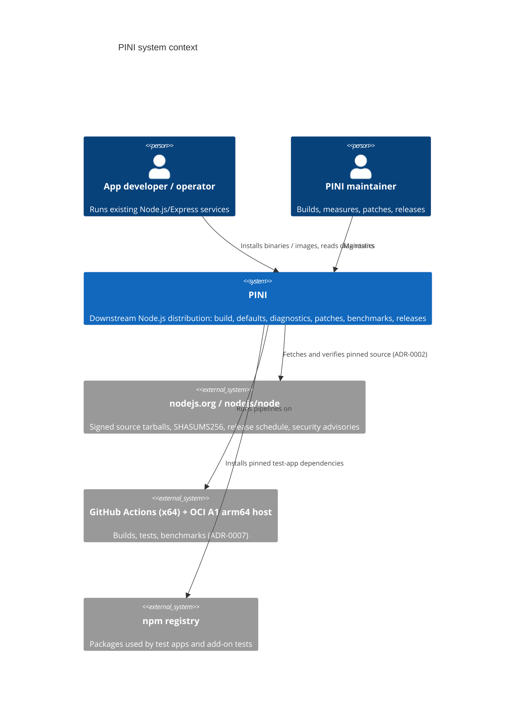

# PINI — Architecture

| | |
|---|---|
| **Status** | Approved 2026-10-12. Owner decisions D-01 and D-03 to D-07 were accepted on 2026-10-12 and are applied (see decision-log.md). |
| **Role in doc set** | Index and architecture overview. Every other doc assumes this one. |
| **Charter** | [vision.md](vision.md) is the source of truth. If this doc and the charter disagree, the charter wins and this doc gets fixed. |
| **Last revised** | 2026-10-12 |

---

## 0. Document map (master index)

All paths are relative to the repository root.

| # | Doc | Covers | Status |
|---|---|---|---|
| — | [docs/vision.md](vision.md) | Charter: vision, principles, scope, roadmap. ADR-0001 is locked here. | Established |
| 00 | [docs/architecture.md](architecture.md) | This doc: index, proposed architecture, cross-cutting decisions, build pipeline, artifact identity | Approved 2026-10-12 |
| 01 | [docs/memory-strategy.md](memory-strategy.md) | Memory model and vocabulary, metric definitions mapped to real APIs, hypotheses H1–H8, experiment protocol, diagnostics report v0 spec (layer 3) | Approved 2026-10-12 |
| 02 | [docs/benchmark-methodology.md](benchmark-methodology.md) | Workloads W1–W5, comparison matrix M1–M4, measurement procedure, statistics, report template | Approved 2026-10-12 |
| 03 | [docs/compatibility-matrix.md](compatibility-matrix.md) | Platforms, Node.js API areas, Express, native add-ons and ABI, known limits | Approved 2026-10-12 |
| 04 | [docs/security-policy.md](security-policy.md) | Security requirements, upstream tracking, patch review, diagnostics privacy, vulnerability handling | Approved 2026-10-12 |
| 05 | [docs/test-strategy.md](test-strategy.md) | Test tiers T0–T4, mapping to upstream `make` targets, PINI suites, release gates | Approved 2026-10-12 |
| 06 | [docs/deployment.md](deployment.md) | Install, runtime dependencies, containers, memory budgeting, operations | Approved 2026-10-12 |
| 07 | [docs/release-process.md](release-process.md) | Versioning, channels, release manifest, upstream-upgrade runbook, security fast-track, rollback | Approved 2026-10-12 |
| 08 | [docs/decision-log.md](decision-log.md) | ADRs (ADR-0001 accepted; ADR-0002 to ADR-0011 proposed or open) and open business decisions | Approved 2026-10-12 |
| 09 | [docs/project-plan.md](project-plan.md) | Risk and rollout (definition of done, phase order, early prerequisites, scope guard) **and** the pre-code implementation plan (task breakdown, traceability, go/no-go) | Approved 2026-10-12 |
| 10 | [docs/progress.md](progress.md) | Current phase, done, blockers, next | Live |
| 11 | [docs/context.md](context.md) | Brief for coding agents: current state, verified facts, rules, commands | Live |
| — | [upstream/version-lock.md](../upstream/version-lock.md) | Pinned Node.js/V8 versions, hashes, toolchain. Currently a template with a recommended candidate | Template |
| — | [README.md](../README.md), [SECURITY.md](../SECURITY.md), [CONTRIBUTING.md](../CONTRIBUTING.md) | Root stubs | Stub |

**No stakeholder rollup doc.** Right now the people who decide are the people who build. The charter (vision.md §1, §8, §13) already gives the plain-language summary, so a separate rollup would only duplicate it. Revisit this at Phase 6 (developer preview), when there are outside evaluators.

**Numbering convention.** The charter's §14.1 file names are canonical and stay un-numbered on disk. The `#` column above exists for cross-references only ("see doc 02 §4" means benchmark-methodology.md §4).

---

## 1. Current state

As of 2026-10-12 nothing exists except `docs/vision.md` and the docs in this set. There is no source, no git repository, no CI, and no build host. This section therefore describes the **proposed** architecture. Facts about upstream Node.js cited here were verified this session against upstream sources (see §8). Anything not verified is labelled *Assumption*.

---

## 2. System context (C4 level 1)



PINI never sits on a request path between a user's app and anything else. It *is* the runtime binary, `node`-compatible, with the same API surface as the upstream release it is built from.

---

## 3. Containers (C4 level 2): what PINI actually is

PINI is a set of *repository-owned artifacts* plus a *build process* that turns a verified upstream tarball into a distributable runtime.

| Container | Lives in (charter §15) | Owns | Charter layer |
|---|---|---|---|
| Upstream lock | `upstream/version-lock.md` (+ machine-readable lock, see §5.2) | Exact Node.js version, V8 version, tarball SHA-256, signature verification record, support window | 1 |
| Source fetcher/verifier | `tools/build/` | Download tarball, verify GPG signature on `SHASUMS256.txt.asc` and SHA-256, extract to a scratch tree | 1/2 |
| Build configuration | `config/build/` | `configure` flag sets per flavor (`stock`, `pini`, `pini-exp-*`), toolchain pin | 2 |
| Patch series | `patches/node/`, `patches/v8/` | Ordered patch files plus a series file. Empty until Phase 4 or 5. | 5 |
| Runtime defaults | `config/runtime/` | Documented default flags/env per profile (Phase 4+). Empty at first. | 4 |
| Diagnostics tooling | `tools/diagnostics/` | Memory report v0 (doc 01 §7), samplers | 3 |
| Benchmark harness | `benchmarks/`, `tools/benchmark/` | Workloads W1–W5, runner, result schema, report generator | 6 |
| Test suites | `tests/` | PINI-specific tests; drives upstream suites | 6 |
| Release tooling | `tools/release/`, `.github/workflows/` | Packaging, manifest, checksums, signing, provenance | 7 |
| Build outputs | `artifacts/` (gitignored) | Binaries, tarballs, images, result JSON | — |

### 3.1 Data flow

```text
version-lock ──► fetch + verify (SHA-256 + gpgv) ──► scratch source tree
                                                        │
                       patches/ (series, `git apply`) ──┤  (no-op until patches exist)
                                                        ▼
            config/build/<flavor>.flags ──► ./configure ... ──► make -jN (or ninja)
                                                        │
                                                        ▼
                         out/Release/node ──► tests (doc 05) ──► benchmarks (doc 02)
                                                        │
                                                        ▼
                     release manifest + checksums + signature (doc 07) ──► artifacts/
```

---

## 4. Charter layers mapped to concrete boundaries

The layer table in vision.md §7 is normative. This section adds the *technical boundary* for each layer, meaning what a change in that layer is allowed to touch.

| Layer | May touch | Must not touch | First phase with real content |
|---|---|---|---|
| 1 Upstream | Nothing. It is read-only input. | — | 1 |
| 2 Build & config | `configure` flags, toolchain, `--tag`/`--release-urlbase` (see §6), packaging | Upstream source files | 1 (stock), 2 (pini) |
| 3 Diagnostics | Out-of-process samplers; in-process preload modules using public Node APIs only | Node internals (`internalBinding`, `--expose-internals`) in shipped tooling | 3 |
| 4 Memory policy | Runtime flags/env that upstream already supports (doc 01 §4) | Defaults baked into the binary, unless backed by an accepted Phase 4 experiment | 4 |
| 5 Patches | Upstream source via reviewed patch files only | Anything without a reproducing workload, baseline, and regression test (vision §5.2) | 5 at earliest |
| 6 Tests & benchmarks | Own harness; upstream test runner (`tools/test.py`, `make` targets) | Editing upstream tests to make them pass | 1 |
| 7 Release | Packaging, signing, publishing | Shipping before doc 05 release gates pass | 2 (internal), 6 (external) |

---

## 5. Cross-cutting architecture decisions

Each decision has a full ADR in doc 08. The summary here is what every subsystem doc builds on.

### CD-1. Distribution, not engine (ADR-0001, **accepted, locked**)

Covered by charter §6.1. Consequence for all docs: a proposal that cannot be expressed as a build flag, a runtime flag, a tooling change, or a small reviewed patch is out of scope until the charter's §9 gates say otherwise.

### CD-2. Upstream enters as a verified release tarball, not a fork (ADR-0002, *proposed*)

- **Input:** `https://nodejs.org/dist/vX.Y.Z/node-vX.Y.Z.tar.xz`, verified two ways. First, `gpgv` checks `SHASUMS256.txt.asc` against the `nodejs/release-keys` keyring (procedure from upstream README "Verifying binaries"). Second, the tarball's SHA-256 is checked against both the verified `SHASUMS256.txt` and the value recorded in `upstream/version-lock.md`.
- **Why:** this is the artifact upstream signs and ships. It needs no submodule ergonomics, keeps the repo small (charter §15: "no vendored copy"), and the hash recorded in the lock is the hash of the thing we actually build.
- **Verified this session:** the v26.11.1 source tarball contains `test/` (all upstream JS/native suites) and `benchmark/`. It does **not** contain V8's own test suite: only 4 files under `deps/v8/test/`. Consequence: if a V8 patch is ever proposed (Phase 5+), V8's tests must come from a separate pinned V8 git checkout. That is recorded as a prerequisite in doc 09 §4.
- **Why not a git fork:** rebasing a fork branch hides the patch set inside history, and the charter wants patches that are "easy to diff against upstream" (vision §5.3). **Why not a submodule:** the GitHub API reports the `nodejs/node` repository at ~1.6 GB (`size: 1644526` KB, 2026-10-12), while the v26.11.1 `.tar.xz` is ~63 MB. That is a lot of history to carry for a read-only input, plus the extra ceremony of submodule updates. Alternatives in full: ADR-0002.

### CD-3. Pin the Node.js 26 LTS line (ADR-0003, *proposed, needs sign-off*)

Verified schedule (nodejs/Release `schedule.json` and README, fetched 2026-10-12):

| Line | Status on 2026-10-12 | Next transition | EOL | Bundled V8 (latest release) |
|---|---|---|---|---|
| 22.x Jod | Maintenance LTS | — | 2027-04-30 | 12.4.254.21 (v22.23.3) |
| 24.x Krypton | Active LTS | Maintenance on **2026-10-20** | 2028-04-30 | 13.6.233.17 (v24.21.0) |
| 26.x | Current | **Active LTS on 2026-10-28**, Maintenance 2027-10-20 | **2029-04-30** | 14.6.202.34 (v26.11.1) |
| 27.x | Alpha from 2026-10-28 (new release model) | Current 2027-04-22 | 2030-04-30 | — |

The recommendation is the first LTS-designated v26 release. It has the longest support window, covering Phases 1–7 without a forced line migration. It is the last line under the old release model (Node.js announcement, 2026-03-10). And v26 adds `total_allocated_bytes` to `v8.getHeapStatistics()` (verified in v26.11.1 `doc/api/v8.md`; absent from v24.21.0), which gives a direct allocation-rate metric that charter §9 stage 1 asks for. The fallback is the latest v24.x. The full trade-off, including v26's heavier build prerequisites, is in ADR-0003 and `upstream/version-lock.md`.

### CD-4. Build in a pinned Linux container whose toolchain matches upstream's official one (ADR-0004, *proposed*)

Upstream official linux-x64/arm64 binaries for v26 are built on "RHEL 8 with Clang 20.1 and gcc-toolset-14-libatomic-devel" (v26.11.1 `BUILDING.md`). The minimum toolchain is "GCC >= 13.2 or Clang >= 19.1". Python 3.10–3.14 is accepted by `configure`. A Rust toolchain (rustc >= 1.86) is needed for Temporal. PINI builds inside an OCI image based on a RHEL 8-compatible distribution with that toolchain, with the image digest recorded in the lock. That gives glibc 2.28 compatibility identical to upstream binaries and keeps toolchain-induced differences out of the comparison matrix (CD-5).

### CD-5. The baseline comparator is *our own* unmodified build; the official binary is a sanity reference

Charter §10 requires that rows M1–M4 "use the same upstream source version". PINI goes one step further: rows M1/M2 (upstream default/tuned) run a binary **we build from the identical verified tarball, with the identical toolchain, and with upstream's configure flags**. Any measured difference is then attributable to configuration or patches, not to compiler differences. The official nodejs.org binary of the same version is benchmarked once per pin as row **M0 (reference)**, to detect whether our toolchain itself moved the baseline. Details: doc 02 §3.

### CD-6. PINI must be API- and version-transparent by default (ADR-0008, *open*)

Existing apps must run unchanged (charter §1). Two verified upstream mechanisms would change what apps see, and both carry compatibility hazards:

- `configure --tag=<x>` appends `-<x>` to the version string (verified: `configure.py` sets `node_tag = '-' + options.tag`, and `src/node_version.h` builds `NODE_VERSION_STRING` with `NODE_TAG`). The result is a **semver pre-release** such as `v26.12.0-pini.1`, which sorts *below* `v26.12.0`. That can break `engines` checks and version gates in tools. *Assumption, to be tested in Phase 2.*
- `process.release` URLs (`--release-urlbase`) drive where add-on build tooling fetches headers. *Assumption based on documented `process.release.headersUrl` purpose; behavior with node-gyp to be verified in Phase 2.*

Default until ADR-0008 is decided: the binary reports the **exact upstream version unchanged**. PINI identity lives in a side-car release manifest (doc 07 §3) and in the diagnostics report. No `--tag` goes into stable artifacts.

### CD-7. Project tooling runs on a stock Node.js LTS, never on the binary under test (ADR-0010, *proposed*)

Harness, report generation, and release tooling run on a separately installed, pinned upstream Node.js. Only workloads and tests run on the binary under test. This avoids a circularity where a PINI regression corrupts the measurement of that same regression. Tooling is ES modules (charter §6.2) with minimal dependencies. pnpm, if needed, is installed standalone and pinned. Corepack is not assumed: v26 `configure.py` has `--with-corepack` but no `--without-corepack`, which implies it is not bundled by default (verified flag presence; the bundling implication is an *assumption*).

### CD-8. Measurement is out-of-process first

RSS, peak RSS, and cgroup memory are sampled from outside the process (`/proc/<pid>/status`, `smaps_rollup`, cgroup v2 `memory.current`/`memory.peak`). In-process APIs (`process.memoryUsage()`, `v8.getHeapStatistics()`, `PerformanceObserver` `gc` entries) are sampled by a preload module whose overhead is itself measured (doc 01 §6, doc 02 §5). Rationale: in-process sampling allocates, so it perturbs exactly the metrics under study.

### CD-9. Linux arm64 first (OCI Always Free), x64 via CI; macOS is a dev convenience — **accepted 2026-10-12 (D-04)**

Charter §6.2 ("Linux x64/arm64 first"). With no infrastructure budget, the build and benchmark host of record is an **OCI Always Free Ampere A1 (arm64)** allocation (ADR-0007). So **Linux arm64 is the first build and benchmark target**. Linux x64 is built and tested on free GitHub Actions hosted runners and is *not* benchmarked for the record until x64 hardware with doc 02 §4.1 controls exists. Benchmark comparisons are valid only within one host. macOS builds are unsupported and unbenchmarked. Note that local macOS builds of v26 need Python ≥ 3.10, while the dev machine has `/usr/bin/python3` 3.9.6 (see context.md).

---

## 6. Build flavors

A *flavor* is a named, versioned `configure` flag set in `config/build/`. Every artifact's manifest records its flavor.

| Flavor | Purpose | `configure` flags (all verified to exist in v26.11.1 `configure.py`) | Matrix row |
|---|---|---|---|
| `stock` | Upstream-equivalent build from the same tarball | none beyond what upstream release builds use. The exact set is reconstructed from the official `config.gypi` (shipped in `node-vX-headers.tar.gz`) and recorded in Phase 1 | M1, M2 |
| `pini` | PINI-branded build (Phase 2) | `stock` + identity mechanism per ADR-0008 + patch series (empty at first) | M3 |
| `pini-exp-ptrcomp` | Pointer-compression experiment (Phase 4, ADR-0006) | `stock` + `--experimental-enable-pointer-compression` | M4 |
| `pini-exp-*` | Other build-level levers, one per experiment | e.g. `--v8-enable-hugepage` (Linux-only per help text), `--enable-lto`, `--v8-lite-mode` (help text: "implies no just-in-time compilation support, thus much slower execution"; reference only, not a candidate) | M4 |

**Reproducibility hazards found in upstream `configure` (v26):**

- If neither `--v8-enable-temporal-support` nor `--v8-disable-temporal-support` is passed, `configure.py` probes for `cargo`/`rustc` and silently disables Temporal if they are missing (v26.11.1 `BUILDING.md` "Building Node.js with Temporal support"). **Every flavor must pass one of these explicitly.** The official v26.11.1 build has `v8_enable_temporal_support: 1` (headers `config.gypi`).
- `--use-largepages` is documented as "no longer supported and a no-op". Do not list it as a lever.

---

## 7. Artifact identity

Every build produces a manifest (schema owned by doc 07 §3) with at minimum: PINI version, flavor, Node.js version, V8 version (with `-node.N` embedder suffix), tarball SHA-256, patch-series revision and per-patch hashes, `configure` command line, toolchain image digest, compiler versions, build host arch, and timestamp. The runtime itself exposes Node and V8 versions through `process.versions`, which stay unchanged per CD-6.

---

## 8. Acceptance criteria — build and upstream intake (BLD-AC)

UP-AC-1/2 (source verification) live in doc 04 §2.

- **BLD-AC-1** The `stock` flavor builds from the verified, pinned tarball inside the pinned image (by digest), from a clean checkout, with one documented command.
- **BLD-AC-2** The `config.gypi` of our `stock` build matches the official release's `config.gypi` (from the headers tarball) except for a documented list of expected differences (paths, host-specific values).
- **BLD-AC-3** *(Adapted for a solo developer, D-05, 2026-10-12.)* A **freshly provisioned clean VM** with no prior state, set up only by following the docs, rebuilds BLD-AC-1 from scratch. The resulting binary's SHA-256 is compared with the original build. If they differ, each differing section is identified and documented (see doc 04 §3.4). This stands in for the charter's "another developer reproduces the build".
- **BLD-AC-4** Every flavor's flag file passes exactly one of `--v8-enable-temporal-support` / `--v8-disable-temporal-support`. A CI check enforces this.
- **BLD-AC-5** Every build emits a release manifest (doc 07 §3, REL-AC-1) including the image digest and the full `configure` argv.

---

## 9. Verification ledger for this doc

| Fact | Source | How |
|---|---|---|
| Release schedule, phases, EOL dates | `nodejs/Release` `schedule.json` + README @ main | curl, 2026-10-12 |
| New release model from v27, v26 last of old model | nodejs.org blog "Evolving the Node.js Release Schedule" (2026-03-10) | WebFetch |
| Bundled V8 per release | `nodejs.org/dist/index.json`; `common.gypi` `v8_embedder_string` (v26.11.1: `-node.37`; v24.21.0: `-node.53`) | curl |
| Toolchains, Python range, Rust/Temporal, libatomic | v26.11.1 `BUILDING.md`, `configure` | curl |
| `configure` flags and help text | v24.21.0 and v26.11.1 `configure.py` | curl + grep |
| Official builds ship without pointer compression | `config.gypi` in v24.21.0 / v26.11.1 headers tarballs (`v8_enable_pointer_compression: 0`); local `process.config` on 24.14.1 | curl/tar; `node -p` |
| Tarball contents (`test/`, `benchmark/`, V8 tests absent) and SHA-256 | Downloaded `node-v26.11.1.tar.xz`, `shasum -a 256` matched `SHASUMS256.txt` | curl/tar |
| `--tag` semantics | v26.11.1 `configure.py` and `src/node_version.h` | source read |
| Semver ordering effect on tools | — | *Assumption*, test in Phase 2 |
